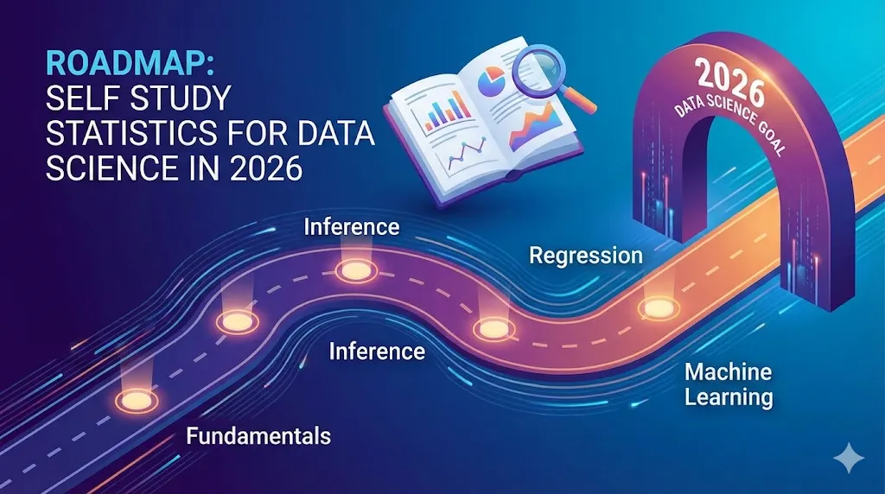

# Data Analysis Roadmap - Statistics Using Python

## About the Project

Welcome to the Data Analysis Roadmap in Python! In this repository, you will find exercises and practical examples adapted from the book *"Manual de Análise de Dados: Estatística e Modelagem Multivariada com Excel, SPSS, Stata"* by professors Luiz Paulo Fávero and Patrícia Belfiore[cite: 2].

Here, you will have the opportunity to explore key data analysis concepts using the Python programming language.

This repository is a valuable study resource that complements one of the most renowned books in the field of data analysis.

We hope it helps you improve your skills and knowledge in data analysis.

Additional topics on what we need to solve Machine Learning and Deep Learning problems will also be added over time.

## Technologies Used

- Python:       3.12.3
- Pandas:       3.1.1
- NumPy:        2.5.5
- Matplotlib:   3.11.2
- Seaborn:      0.13.2
- SciPy:        1.18.1
- Statsmodels:  0.15.0
- Scikit-learn: 1.9.1

## Getting Started

To start exploring the Data Analysis Roadmap in Python, follow these steps:

1. Clone this repository to your local environment.
2. Install the dependencies: `pip install pandas numpy matplotlib seaborn scipy statsmodels scikit-learn jupyter`.
3. Open the notebooks in Jupyter or VS Code and run them locally. Each chapter contains practical examples and exercises to help you practice and deepen your knowledge of data analysis with Python.
4. Some chapters use the book's datasets (`.dta` files), available on the publisher's website. Place these files inside a `dados/` folder at the root of the repository.

---

# Data Science Learning Roadmap

Hello! If you are here, it means you are interested in the field. I will share some points I consider essential for learning, along with general tips. **Do not rely solely on this roadmap; there are others written by more experienced people.**

## 1. Main "Motto" of the Field

- Your role as a data scientist/analyst is to translate and interpret what our analyses mean to someone outside this world, equipping that person with information so they can make better decisions.
- The software you use to perform the analysis is a **means** to an **end**, which is the result.
- Communication skills are also essential.

## 2. Skills - What to Learn

### 2.1. General

- **Stay focused and try your best to keep learning continuously:** Just like anything else you want to learn, this is essential in our field as well. There are many branches and topics to study in data science, so be careful not to lose focus.
- **Stay calm and, if you have faith, hold on to it:** It is a learning process. Just like learning to play the guitar, you won't magically start playing chords overnight. Likewise, you won't suddenly start building Deep Learning models at the level of NVIDIA engineers.

### 2.2. Technical

- **Statistics**:
  - Exploratory Data Analysis: descriptive measures such as mean, median, standard deviation, etc. (I recommend checking out the book *"Estatística Básica"* by Bussab and Morettin).
  - Correlation: positive and negative, what influences two variables to be correlated, and the issue of causality.
  - Hypothesis testing: the most common probability distributions (such as Normal, Binomial, and Exponential), p-value, and confidence intervals (I recommend the same book mentioned above).
  - Regression: understand the logic behind it and a bit of matrix multiplication. Work through a **linear** and a **logistic** regression example by hand. Study how **Ridge** and **Lasso** work. There are other interesting ones to know as well, such as **Quantile** regression and **ElasticNet**.
  - Time series: stationarity, trend, seasonality, autocorrelation, moving averages, unit root tests, models (ARIMA, Holt-Winters, etc.), and model evaluation metrics (Mean Squared Error, Mean Absolute Error, etc.).
  - Other topics that are not as essential at first, but still interesting:
    - Sampling
    - Bayesian Inference

- **Machine Learning**: Many topics in this field are evolutions or reinterpretations of statistical or computational concepts.
  - Models:
    - Know the difference between **supervised** (classification or regression), **unsupervised**, and **reinforcement** learning models.
    - Supervised:
      - Naive Bayes
      - KNN
      - Tree-based models: Decision Trees and Random Forest. Understand hyperparameters and how these models make decisions.
      - Gradient Boosting Machines: a different learning approach in models. Widely used today in implementations like **XGBoost**, **LightGBM (LGBM)**, and **CatBoost**.
    - Unsupervised:
      - K-means (the most widely used)
      - If you are really interested in the topic: Hierarchical clustering, though you can safely skip it at first.
  - Evaluation metrics:
    - Classification: Confusion Matrix, Accuracy, Recall, Precision, F1-score.
    - Regression: R², MSE, RMSE, MAE, and many other acronyms out there.
  - The absolute basics of NLP (Natural Language Processing).
  - Other topics not as essential at first, but interesting:
    - Deep Learning
    - Computer Vision

- **Software & Tools**:
  - **Python**: Yes, you use Python everywhere: data analysis, machine learning, automation, etc. It has the largest number of tutorials, both in English and in Portuguese.
  - **SQL**: Mandatory. After learning some Python programming basics, move on to SQL to learn DQL (Data Query Language), which covers querying data.
  - **Excel**: Learn the basics, at least up to `VLOOKUP`. It is arguably the most widely used software in professional environments. There are plenty of quick workarounds you can pull off in Excel that aren't as straightforward in Python.
  - **Git**: With this tool, you can "go back in time" to recover a previous change, and you can track every modification you make to your code.
  - **After all of the above, if you have time — Visualization Software**: Power BI, Tableau, etc. I don't have a preference because I personally hate building dashboards.

## 3. How to Learn

- **A little bit of theory and a lot of practice.** Study, then immediately document everything and publish it somewhere public.
- **Learn through projects**: *"Oh, I want to learn about Random Forest."* Open a Python notebook/file right away, open 500 tabs of theory about the model, summarize what you understood, and apply it to a dataset. *"What projects can I do?"* Check out this [tutorial](https://www.analyticsvidhya.com/blog/2018/05/24-ultimate-data-science-projects-to-boost-your-knowledge-and-skills/).
- **Build a portfolio:** This is something I have heard since I was an intern at SEFA (2017 or 2018) and followed the [Datahackers Slack](https://www.datahackers.com.br/slack/). If you want to break into the field and don't have someone to hold your hand and refer you to a job, this is the best way.
  - **Why**: Basically, the idea is to have a place where people can see and follow your work, projects, and learning journey.
  - **Where**: Anywhere you can host your code. For convenience, my recommendation is right here on GitHub. You can also create a personal blog.
- **Share your learning and projects:** Yes, share them. It doesn't help to make progress if no one knows what you are learning. For this, [LinkedIn](https://www.linkedin.com) is still the best platform. It is a professional network with recruiters, data managers/coordinators, and other students. There are other places too, like data/statistics communities, but I would recommend focusing on LinkedIn.
  - Be consistent with your posts. Try posting about what you have learned.
  - Make connections: send connection requests to people whose profiles mention data, data science, etc. That's the famous *networking*.
  - Keep a well-detailed profile aligned with your future goals: you can check some tips on organizing your LinkedIn [here](https://twitter.com/camelouu/status/1409886433515606027), [here](https://twitter.com/camelouu/status/1522237678921601025), and in this [tutorial](https://twitter.com/pygineering/status/1539682926551523328), which is a bit more specific to our field.

### How this learning process worked for me:

1. I decided I wanted to learn about Decision Trees.
2. I gathered a few easy-to-read links (theory) along with some links that included code (practice).
3. I opened a Jupyter Notebook. In Part 1, I wrote a summary of the theory I learned.
4. In Part 2, I put it into practice with code, training algorithms and testing different libraries.
5. I [documented it well](https://nbviewer.org/github/barbosarafael/Projetos/blob/master/Arvore_de_decisao_CART/arvore_de_decisao.ipynb) (I think).
6. And I started [posting project updates on LinkedIn](https://www.linkedin.com/posts/rafael-barbosa0_datascience-activity-6684090468579479552-aaNt?utm_source=share&utm_medium=member_desktop).

## 4. Courses

- [Introdução à Ciência de Dados 3.0](https://www.datascienceacademy.com.br/cursosgratuitos): **Free** (in Portuguese). Great for getting an overview of the field, its goals, and future prospects.
- [Fundamentos de Linguagem Python Para Análise de Dados e Data Science](https://www.datascienceacademy.com.br/cursosgratuitos): **Free** (in Portuguese). Focused on hands-on Python, so you learn both Python and data analysis.
- [Formação Cientista de Dados: O Curso Completo [2023]](https://www.udemy.com/course/cientista-de-dados/): **Paid** (in Portuguese), very comprehensive, with great reviews for both the instructor and the curriculum. It is practice-focused, which is ideal for learning.
- [Curso de SQL Completo Gratuito (BD-03)](https://www.softblue.com.br/site/curso/id/3/CURSO+SQL+COMPLETO+BASICO+AO+AVANCADO+ON+LINE+BD03): **Free** (in Portuguese). When I took it, it gave me a solid foundation for writing queries and understanding other SQL structures. I recommend finishing this course and jumping into SQL exercises on [these suggested websites](https://github.com/barbosarafael/Aprendizado-SQL).
- Udacity Nanodegrees: I would recommend these for people who are already working in the field.
- There are also many free websites offering great tutorials: Medium, StackOverflow, Towards Data Science, etc.

## 5. Recommended Books

### 5.1. Books that will make you think:

- *The Lady Tasting Tea*
- *The Drunkard's Walk*
- *How to Lie with Statistics*
- *The Black Swan*
- *Thinking with Data*

### 5.2. Technical books:

- *Storytelling with Data*
- *Data Science for Business*
- *An Introduction to Statistical Learning*
- *Practical Statistics for Data Scientists*
- *Estatística Básica* (Bussab & Morettin)
- *R for Data Science*
- *Hands-On Machine Learning with Scikit-Learn*
- *Fundamentals of Data Visualization*

## 6. General Tips

- Exploratory Data Analysis (the stage where you explore your data) is heavily underrated. If you don't explore your data properly, your downstream models/systems may end up biased or simply built on inconsistent information.
- Don't obsess over learning the hardest models like Deep Learning, Gradient Boosting, and all those fancy names. Learn the fundamentals of how a model learns and how metrics work. Often a simple model is more than enough to solve a simple problem—and most of the time, you don't even need a machine learning model at all.
- If possible, find an industry professional to be your mentor. If you can't, post your conceptual or coding questions in a community and people will help you. The data community in Brazil is generally very welcoming.
- Never stop studying, even after landing a job. Of course, respect your own pace and time.
- Develop critical thinking. Start asking yourself questions like: *"Where did this data come from?"* or *"If we use variable X, aren't we impacting variable Y?"*
- Don't focus exclusively on "Data Scientist" job titles: there are other roles that do the exact same work under different titles. Read job descriptions very carefully.
- It is completely normal to start in data science and branch out into related areas such as Data Engineering, Machine Learning Engineering, academic research, etc.